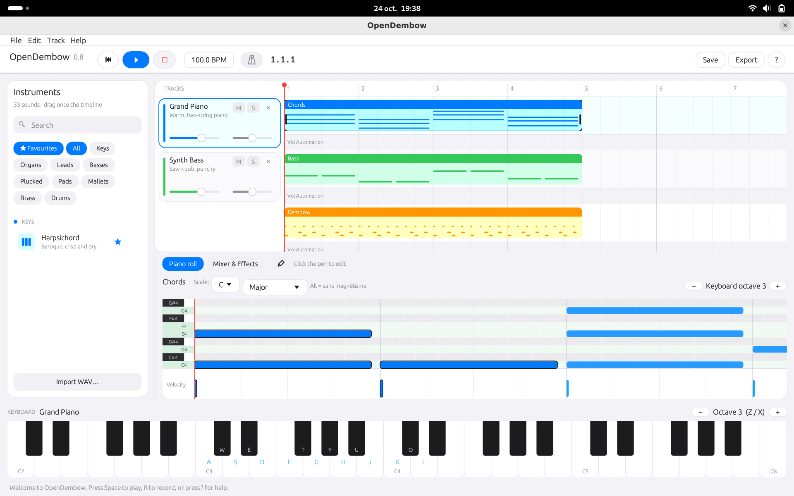
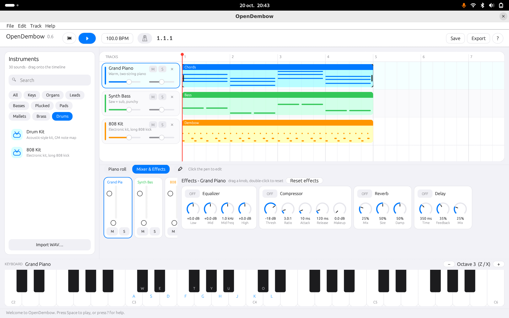
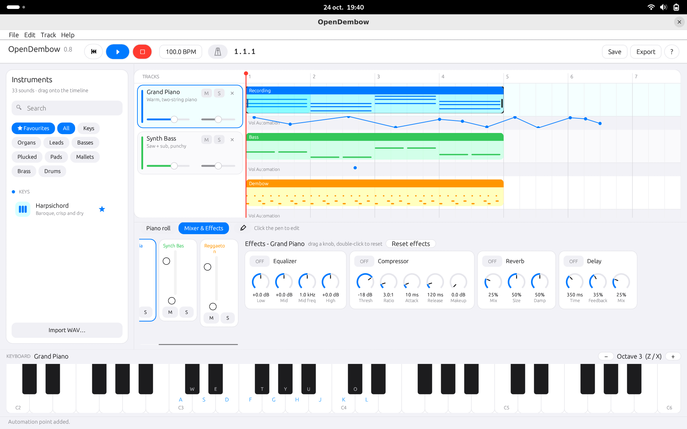

# OpenDembow 0.10





A modern, elegant digital audio workstation written in Rust. Clean light interface, one accent colour,
rounded everything - a calmer layout where you can hide what you do not use, see what you hear, and loops that never slip.

## Run
``` bash
cargo run --release
```

Requires stable Rust (https://rustup.rs). On Linux: `sudo apt install libasound2-dev pkg-config` (used for both audio output and MIDI input).

Dependencies in `Cargo.toml` (0.10 adds none: the FFT and the lock-free audio tap are written in the project):

```toml
eframe = "0.29"
cpal = "0.15"
hound = "3.5"
rfd = "0.15"
serde_json = "1"   # MCP server
midir = "0.11"     # MIDI input
```

Set `version = "0.10.0"` in `Cargo.toml`: the version number shown in the transport bar follows it.

## What's new in 0.10
**Rock-solid loops: the loop now runs inside the audio engine**
- **Fixed: the playhead could escape the loop** after a few repetitions. The old loop was checked once per interface frame, so a late frame (spectrum drawing, a slow window) could miss the moment the playhead crossed the loop end, and the playhead then carried on past it
- The loop is now handled **in the audio callback, sample by sample**: when the playhead reaches the loop end inside an audio buffer, the engine renders up to that exact sample, jumps back to the loop start and keeps rendering. It cannot miss a pass, and there is **no drift and no accumulated error**, whatever the frame rate of the interface
- As long as the loop is on, the playhead never leaves it. Turn the loop off and playback simply continues
- Notes still ringing when the loop wraps are released, so tails do not pile up from one pass to the next
- A playhead placed after the loop end plays on normally
- A tempo change is taken into account immediately (the interface sends the loop range to the engine every frame)
- The loop interface itself is unchanged: same loop bar, same shortcuts

**Saved with the project**
- The **loop range** (start, end, on / off) is now saved in the `.dembow` file and restored when you open it
- **Volume automation is saved too**: before this fix the automation points were lost every time a project was saved
- Older projects still open (they simply have no loop and no automation)
- The version number in the transport bar now really follows `Cargo.toml` (it used to show a fixed number)

## What's new in 0.9
**See your sound: Master spectrum and dBFS meters**
- A **Master** card in the Mixer & Effects tab shows a real-time **spectrum analyzer**: 4096-point FFT (Hann window), logarithmic frequency axis from 20 Hz to 20 kHz, level in dB, smooth gradient curve
- Hover the spectrum to read the **frequency, the nearest note and the level** under the cursor
- **Hold** keeps a thin peak curve that falls slowly; **Tilt** adds +4.5 dB per octave so the spectrum looks like what you hear
- Two thin **stereo dBFS meters** (-60 to 0 dB) with green / amber / red zones, a peak-hold line and a **clip LED**; click to reset. The Master meters read the signal before the soft limiter, so an over 0 dBFS is never hidden
- Every track strip in the mixer now has the same **dBFS meter** (hover for the held peak, click to reset); the small level bar in the track headers follows the same dB scale
- The audio thread only writes atomics into a ring buffer: **no lock and no allocation** for the analyzer, the FFT runs in the interface thread

**A calmer interface for beginners**
- **Hide what you do not use**: the instrument browser, the piano roll & mixer panel and the on-screen keyboard each have a small **panel icon** (a window with a filled side). Hover it: the tooltip says *Hide ...*
- A hidden panel collapses into a thin strip with a **blue** icon and its name; one click brings it back. Nothing ever disappears for good
- **View menu** with the three panels, **Focus on the timeline** (everything hidden, more room for the arrangement) and **Show everything**
- The version number in the transport bar now follows `Cargo.toml`

## What's new in 0.8
**Ableton-style note editing in the piano roll**
- **Multi-selection**: drag a rectangle on empty space, `Shift+click` to add / remove notes, `Ctrl+A` to select all, `Esc` to deselect
- **Group editing**: moving or resizing a selected note moves or resizes the whole selection, keeping intervals and spacing
- **Alt = no snap**: hold `Alt` while dragging, drawing or resizing to ignore the grid
- **Keyboard editing**: `↑ ↓` transpose by a semitone, `Shift+↑ ↓` by an octave, `← →` nudge by one grid step, `Shift+← →` change note length
- **Quantize** (`Ctrl+U`): snap the start of the selected notes to the grid
- **Duplicate** (`Ctrl+D`): copies the selected notes right after themselves (with no note selected, it duplicates the clip as before)
- **Velocity badge**: hover or select a note and a small **V** badge appears just after it; its fill shows the velocity at a glance, and a click opens a vertical slider (1-127). The whole selection follows
- **Copy / cut / paste several notes** at once; pasted notes become the selection, and the pen's Size setting applies to every selected note
- Right-click on a selected note deletes the whole selection

**Loops, Ableton style**
- A thin **loop bar** sits above the bar numbers. Drag in it to draw the part that repeats, drag the brace to move it, drag its edges to resize it (`Alt` = no snap)
- The brace is amber when the loop is on and grey when it is off; the looped region is tinted on the timeline
- Click the brace, press `Ctrl+L` or use the **Loop** button in the transport bar to switch it on or off; `Ctrl+Shift+L` loops the selected clip
- Right-click the bar for more: loop the selected clip, or loop 1 / 2 / 4 / 8 bars from the playhead
- The playhead jumps back at the end of the loop (sample-accurate since 0.10)

**Volume automation, redesigned**
- Each track has a pink automation lane under its clips, separate from the clips
- **0 / 50 / 100 %** guides are always visible, and values snap to them (`Alt` = free)
- A **ghost point** shows exactly where a click will place a point, with its value
- Click to add a point, drag a point to move it, right-click a point to delete it

**Timeline and playhead**
- The red playhead is a real handle: open hand on hover, closed hand while dragging. It snaps to the grid (`Alt` = free) and shows its position (`bar.beat.sixteenth`)
- Clicking or dragging in the ruler moves the playhead, with a hover guide
- **Reorder tracks**: drag a track header; a blue line shows where the track will land
- **Instrument drops**: dropping an instrument on the middle of a track swaps its instrument and keeps every clip and note; dropping near the edge between two tracks inserts a new track there

## Features
- **33 built-in synthesized instruments** in 9 categories: Keys, Organs, Leads, Basses, Plucked, Pads & Strings, Mallets & Bells, Brass & Winds, Drums & Percussion
- **Sample-accurate loops** (0.10): the loop runs inside the audio engine, so the playhead never leaves it while the loop is on (see above)
- **Master spectrum analyzer and dBFS meters** (0.9): see the whole mix in real time (see above)
- **Hideable panels and Focus mode** (0.9): instruments, piano roll & mixer and keyboard can be hidden; View menu, panel icons and shortcuts
- **Recording with count-in** (0.7): press `R` or the red button, hear a 4-beat count-in, then play - the notes you play become a new MIDI clip (undo with Ctrl+Z)
- **MIDI input** (0.7): plug in a MIDI keyboard or controller and pick it in Track > MIDI Input; it plays the selected track and records like the computer keyboard
- **Drum names in the piano roll** (0.7): on a drum track every row shows the name of its pad, following the map of the kit
- **Favourite instruments** (0.7): click the star on an instrument, then use the ★ Favourites filter in the browser; favourites are saved in `~/.opendembow_favorites`
- **Drums** (0.6): five kits - **Drum Kit**, **808 Kit**, **Trap Kit**, **Reggaeton Kit** (dembow) and **Latin Percussion** (congas, bongos, timbales, shakers)
- **Instruments added in 0.6**: 808 Bass, Fingered Bass, Electric Guitar, Synth Pluck
- Ableton-style instrument browser: search box, category filters, favourites, instruments grouped by category
- Drag instruments from the browser onto the timeline (new track, or drop on a track to swap its instrument)
- Metronome click: toggle with the transport button or `M`, accented first beat, volume, beats per bar, latency compensation (right-click)
- On-screen piano keyboard (4 octaves, can be hidden) + computer-keyboard playing (A W S E D F T G Y H U J K O L)
- Delete tracks with the × on the track header, the Track menu, or right-click
- Multi-track arrangement, piano roll
- **Mixer & Effects tab**: one strip per track (volume, pan, mute, solo, dBFS meter), the **Master** card and, for the selected track, a 3-band **equalizer**, a **compressor**, a stereo **reverb** and a ping-pong **delay**; effects run before volume / pan, are included in the mixdown, the stems and the live output, and are saved in the project
- **Clip editing**: split at the playhead, trim start / end, cut / copy / paste clips and notes, clip length, normalize and reverse audio
- **MCP server**: let an AI assistant build and mix your song (it knows the drum map too)
- Audio tracks: import WAV (drag & drop or menu)
- Menu bar (File / Edit / Track / View / Help) and a "?" help button (F1)
- Save / open projects (`.dembow`: tracks, clips, effects, volume automation and loop range), undo / redo (Edit menu, Ctrl+Z)
- Export: mixdown WAV, stems (one WAV per track), MIDI file
- **Volume Automation** (0.7, redesigned in 0.8): click directly in the dedicated bottom lane of any track to add automation points and draw smooth volume curves
- **Loops** (0.8): Ableton-style loop bar above the timeline
- **Scale-Aware Piano Roll** (0.7): select a root note and scale (Major, Minor, Pentatonic, Blues) to colour in-scale notes with a subtle green tint, shade out-of-scale notes, and show key labels

## Master: what is it for?
The Master is the final output: every track is summed into it before it reaches your speakers and the exported WAV.
- **Meters**: they show the total level of the song. If they touch 0 dB the clip LED lights up and the sound may distort - lower the track volumes
- **Spectrum**: it shows where the energy is, bass on the left and treble on the right. A tall curve on the left means a lot of bass, a low curve on the right means a dull mix

Click the peak value in the card header (or a meter) to reset the peaks and the clip LED.

## Layout and panels
Three parts of the window can be hidden to give the timeline more room. Each one has a small panel icon; hover it to read *Hide ...*.

| Panel | Icon position | Shortcut |
|---|---|---|
| Instruments (left) | Top right of the browser card | `Ctrl+B` |
| Piano roll & Mixer (bottom) | On the top edge of the panel | `Ctrl+J` |
| On-screen keyboard (bottom) | On the top edge of the panel | `Ctrl+Shift+K` |
| Focus on the timeline / show everything | View menu | `Ctrl+Shift+F` |

A hidden panel leaves a thin strip with a blue icon: click it to bring the panel back. The panel layout is not saved in the project (every panel is visible at start-up).

## Recording and MIDI input
1. Select an instrument track (click its header, or drop an instrument on the timeline).
2. Optional: connect a MIDI keyboard and choose it in **Track > MIDI Input** (the first device found is connected at start-up; **Refresh devices** rescans).
3. Press `R` or the red ● button. A 4-beat count-in plays (switch it off in **Track > Count-in before recording**; `Esc` cancels it).
4. Play: on the on-screen keyboard, your computer keys or the MIDI controller. The rest of the song plays along.
5. Press `R` or `Space` to stop. A new clip called "Recording" appears on the track, starting on a bar line.

Notes: the velocity of a MIDI controller is stored in the clip but not yet used by the live sound; there is no automatic quantization while recording, but you can quantize afterwards in the piano roll (select the notes, `Ctrl+U`).

## Piano roll
Select a MIDI clip (or double-click an empty lane to create one) to edit its notes in the bottom panel.

**Drawing and selecting**
- Double-click, or use the pen (`P`) and click / drag, to draw a note; the pen's Grid and Size menus set the snap and the length
- Drag on empty space to draw a selection rectangle; `Shift` keeps the current selection
- `Shift+click` a note to add or remove it; click a note to select only that one
- Hold `Alt` to turn the grid snap off while dragging

**Editing a selection**
- Drag a note to move the whole selection; drag a note's left or right edge to resize (the right edge resizes the whole selection)
- `↑ ↓` / `Shift+↑ ↓` transpose by a semitone / an octave, `← →` nudge by one grid step, `Shift+← →` change the length
- `Ctrl+U` quantizes, `Ctrl+D` duplicates, `Delete` removes, `Ctrl+C` / `Ctrl+X` / `Ctrl+V` copy, cut and paste at the playhead
- `Ctrl+click` a note cuts it at the click

**Velocity**: hover or select a note and click the **V** badge that appears right after it. A vertical slider (1-127) sets the velocity; if the note is part of the selection, every selected note gets the same value.

**Scale**: pick a root and a scale next to the clip name to highlight the notes of the scale (rows, keys and key labels).

## Loops
1. Drag in the thin bar above the bar numbers to choose the part that repeats (it snaps to the beat; hold `Alt` for free positioning).
2. Move the brace by dragging its body, resize it by dragging an edge.
3. Click the brace, press `Ctrl+L` or press the **Loop** button to turn the loop on or off. `Ctrl+Shift+L` loops the selected clip.
4. Right-click the bar to loop the selected clip or to loop 1 / 2 / 4 / 8 bars from the playhead.

Notes: the loop is handled inside the audio engine, so the jump back to the start is sample-accurate and the beat grid never drifts, whatever the frame rate of the interface. While the loop is on, the playhead never leaves it. Starting the playhead after the loop end plays on normally. Notes still ringing when the loop wraps are released. The loop does not apply to the exported mixdown. The loop range is saved with the project and restored when you open it (a project where you never touched the loop saves none).

## Automation
Each track has a volume automation lane under its clips, with 0 / 50 / 100 % guides.
- **Click** in the lane to add a point (a ghost point shows where it will land and its value)
- **Drag** a point to move it; it stays between its neighbours and snaps to the grid and to 0 / 50 / 100 % (`Alt` = free)
- **Right-click** a point to delete it
- Before the first point and after the last one, the value stays flat
- The points are saved in the project file

## Drums
Add a drum kit track (**Drum Kit**, **808 Kit**, **Trap Kit** or **Reggaeton Kit**) and play it with the on-screen keyboard, your computer keys or the piano roll.
Notes are folded into two octaves (MIDI 36-59), so every key of the keyboard plays a drum. The piano roll shows these names next to each row:

| MIDI key | Note | Sound |
|---|---|---|
| 36 | C2 | Kick |
| 37 | C#2 | Rim / side stick |
| 38 / 40 | D2 / E2 | Snare / tight snare |
| 39 | D#2 | Clap |
| 41 / 43 / 45 / 47 / 48 / 50 | F2 ... D3 | Toms (low to high) |
| 42 / 44 | F#2 / G#2 | Closed hi-hat / pedal hi-hat |
| 46 | A#2 | Open hi-hat |
| 49 / 52 / 55 / 57 | C#3 / E3 / G#3 / A3 | Crash cymbals |
| 51 / 53 / 59 | D#3 / F3 / B3 | Ride / ride bell |
| 54 / 58 | F#3 / A#3 | Tambourine-style shaker / shaker |
| 56 | G#3 | Cowbell |

Notes below 36 or above 59 wrap around (60 is a kick again); the piano roll shades those rows. Drum hits end by themselves, so note length does not cut them.

All four kits share this map, so a pattern keeps working when you swap kits. What changes is the sound:
- **Trap Kit**: hard kick with a sub tail, snappy snare, tight hats, long 808 toms; key 59 (B3) is a long **808 boom**.
- **Reggaeton Kit**: boxy dembow kick, bright snare with a short gate, short hats, the toms are **congas**.

**Latin Percussion** has its own map (same two octaves):

| MIDI key | Sound | MIDI key | Sound |
|---|---|---|---|
| 36 / 38 | Conga low / high | 47 | Guiro long |
| 37 / 39 | Conga mute / slap | 48 | Claves |
| 40 / 41 | Bongo low / high | 49 | Maracas |
| 42 / 43 | Timbale low / high | 50 / 58 | Shaker / long shaker |
| 44 | Paila (timbale rim) | 51 | Tambourine |
| 45 | Cowbell | 52 / 53 | Agogo high / low |
| 46 | Guiro short | 54 / 55 | Triangle / cabasa |
| 56 | Woodblock | 57 / 59 | Hand clap / tumba |

The demo song contains a **dembow** beat on the Reggaeton Kit: kick on every beat, snares on the classic 3+3+2 accents, hi-hats on the eighth notes.

## Editing shortcuts
| Key | Action |
|---|---|
| `Space` | Play / pause |
| `R` | Record (count-in, then play; `R` or `Space` to stop) |
| `Home` | Rewind to the start |
| `M` | Metronome on / off |
| `P` | Pen mode on / off |
| `Esc` | Leave pen mode, cancel a count-in, deselect notes |
| `B` | Split the selected clip at the playhead |
| `[` / `]` | Trim clip start / end to the playhead |
| `Ctrl+C` / `Ctrl+X` / `Ctrl+V` | Copy / cut / paste the selected notes or clip (pasted at the playhead) |
| `Ctrl+D` | Duplicate the selected notes (or the clip when no note is selected) |
| `Delete` | Delete the selected notes (or the clip when no note is selected) |
| `Ctrl+L` | Loop on / off |
| `Ctrl+Shift+L` | Loop the selected clip |
| `Ctrl+B` | Show / hide the instruments |
| `Ctrl+J` | Show / hide the piano roll & mixer |
| `Ctrl+Shift+K` | Show / hide the on-screen keyboard |
| `Ctrl+Shift+F` | Focus on the timeline / show everything |
| Drag in the loop bar | Draw / move / resize the loop (right-click for more) |
| Click / drag in a track's automation lane | Add / move a volume automation point |
| Right-click an automation point | Delete the point |
| Drag the red playhead | Move the playhead (`Alt` = no snap) |

Piano roll only (mouse over the roll):

| Key | Action |
|---|---|
| `Ctrl+A` | Select all notes |
| `Shift+click` / drag a rectangle | Add to the selection / select several notes |
| `Alt` (held) | Disable the grid snap |
| `↑ ↓` / `Shift+↑ ↓` | Transpose by a semitone / an octave |
| `← →` / `Shift+← →` | Nudge by one grid step / change the note length |
| `Ctrl+U` | Quantize the selected notes to the grid |
| Click the **V** badge of a note | Set the velocity of the note (or of the whole selection) |

Press F1 inside the app for all shortcuts.

## MCP (Model Context Protocol)
Start the app with `--mcp`: it then speaks MCP over stdio while keeping its window. Example for Claude Desktop (`claude_desktop_config.json`):

```json
{
  "mcpServers": {
    "opendembow": { "command": "/path/to/opendembow", "args": ["--mcp"] }
  }
}
```

Tools: `get_project`, `list_instruments`, `get_notes`, `set_tempo`, `add_track`, `delete_track`, `add_midi_clip`, `add_notes`,
`delete_clip`, `split_clip`, `set_track`, `set_effect`, `transport`, `undo`, `redo`.
Every change goes through the normal undo history and appears live in the window.

## Project files
A `.dembow` project is plain text (tab separated). The `bpm` line may be followed by a `loop<TAB>start<TAB>end<TAB>on` line (in beats).
Each track line is followed by its effect settings (`fx<TAB>reverb.mix<TAB>0.3` ...) when they differ from the defaults,
then by its automation points (`auto<TAB>volume<TAB>beat<TAB>value`, one per point); older projects without these lines still open.
Audio clips are stored next to the project as `<name>.audioN.wav`.

Favourite instruments are not part of a project: they are stored per user in `~/.opendembow_favorites` (one instrument name per line).
The piano roll's note selection and scale choice, the analyzer options (Hold / Tilt) and the panel layout are not saved.

## Layout of the source
- `engine.rs` real-time mixer (one effect chain per track), cpal output, sample-accurate loop wrapping in the audio callback, master tap for the analyzer, offline bounce
- `analyzer.rs` lock-free master tap, FFT spectrum and the Master card - `meters.rs` dBFS meters, peak hold, clip LED
- `view.rs` show / hide panels, panel icons, collapsed strips, View menu
- `instruments.rs` synth voices and instrument categories - `project.rs` data model - `project_io.rs` save/load (loop range, effects, automation) + MIDI export
- `drums.rs` Drum Kit and 808 Kit - `drums_urban.rs` Trap Kit and Reggaeton Kit - `latin.rs` Latin Percussion - `extra_voices.rs` 808 Bass, Fingered Bass, Electric Guitar, Synth Pluck
- `drum_names.rs` pad names shown in the piano roll (one map per kit family)
- `arrangement.rs` timeline: track headers, ruler, clips, playhead - `loops.rs` loop bar and loop region (sends the range to the engine, which does the wrapping; hands the range to / takes it from the project on save / open) - `automation.rs` volume automation lanes
- `pianoroll.rs` note editing, multi-selection, scales - `velocity.rs` the V badge and its velocity slider
- `keyboard.rs`, `chrome.rs` (menus, instrument browser, favourites, help), `theme.rs` interface
- `effects.rs` effect settings, DSP (`FxProcessor`) and the Mixer & Effects panel
- `edit.rs` split / trim / clipboard / audio tools and the bottom-panel tabs
- `record.rs` recording with count-in - `midi_in.rs` MIDI keyboard input (midir)
- `favorites.rs` favourite instruments (saved in the home folder)
- `mcp.rs` MCP server
- `metronome.rs` metronome click (own audio stream) and its transport button
- `files.rs` file commands (new / open / save, exports) - `audio_io.rs` WAV I/O

## Adding an instrument
1. Add a variant to `Instrument` in `instruments.rs` and to `Instrument::ALL` (append at the end to keep old projects compatible).
2. Fill in `name`, `blurb`, `category` and `release_rate`.
3. Write its sound in `Voice::next` (or in `extra_voices.rs` / `drums.rs` to keep files short).

## Roadmap
Next (0.10.x / 0.11): visual equalizer (drag points on the response curve, spectrum behind it), compressor transfer curve with gain-reduction meter,
automation of pan and effect parameters, MIDI velocity in the live sound, saving the panel layout,
LUFS and stereo correlation meters, waveforms with a dB scale.

Later: step sequencer, audio recording, quantization while recording, fold-to-scale in the piano roll, dark theme, a "Designer" synth with filter / envelopes / LFO,
sample-based instruments, instrument preview on hover, drag-to-trim clip edges, send effects.

## License

This project is licensed under the GNU General Public License v3.0 (GPLv3) - see the [LICENSE](LICENSE) file for details.

# Copyright (C) 2026 Jorge Andre Castro